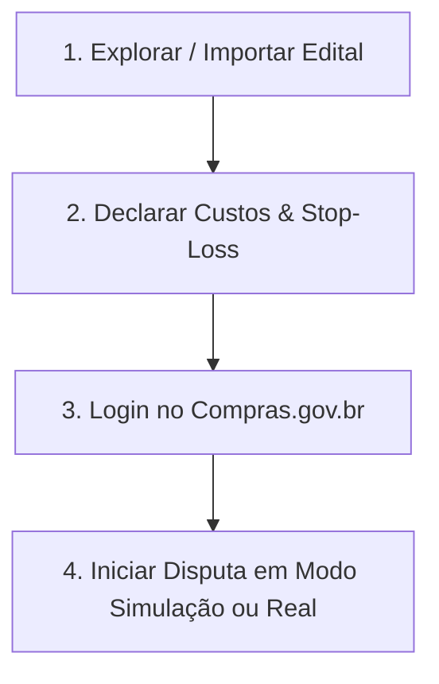

# ⚡ Robô de Licitações JRBC — Manual Completo & Passo a Passo

<div align="center">
  
  <p><b>Manual de Engenharia, Operação de Pregão e Guia de Implantação Comercial</b></p>
  <p><i>Versão 1.0 — 100% em Português do Brasil (PT-BR)</i></p>
</div>

---

## 📌 Sumário
1. [Sobre o Sistema & Arquitetura](#1-sobre-o-sistema--arquitetura)
2. [Configuração Inicial do Ambiente](#2-configuração-inicial-do-ambiente)
3. [Configuração do Banco de Dados (Supabase)](#3-configuração-do-banco-de-dados-supabase)
4. [Como Operar o Robô no Dia a Dia (Passo a Passo)](#4-como-operar-o-robô-no-dia-a-dia-passo-a-passo)
5. [Trava de Segurança & Regras de Lances (Stop-Loss)](#5-trava-de-segurança--regras-de-lances-stop-loss)
6. [Sistema de Licenciamento & Mensalidades](#6-sistema-de-licenciamento--mensalidades)
7. [Como Gerar o Instalador Windows (.exe)](#7-como-gerar-o-instalador-windows-exe)
8. [Suporte Remoto via AnyDesk](#8-suporte-remoto-via-anydesk)
9. [Solução de Dúvidas & Diagnóstico de Erros](#9-solução-de-dúvidas--diagnóstico-de-erros)

---

## 🚀 1. Sobre o Sistema & Arquitetura

O **Robô de Licitações JRBC** é uma solução profissional de automação, inteligência de mercado e assistência de lances voltada para o portal **Compras.gov.br** (Comprasnet Web) e **PNCP (Portal Nacional de Contratações Públicas)**.

### 🧩 Pilares Tecnológicos:
- **Interface Gráfica:** Python com `CustomTkinter` em Dark Mode moderno e responsivo.
- **Automação Web:** `Playwright Chromium` com perfil persistente anti-detecção e latência ultra-baixa.
- **Leitor de Editais & Propostas:** Extração multi-estratégia (RegEx estruturado de alta precisão) com fallback inteligente via **Google Gemini AI**.
- **Banco de Dados em Nuvem:** `Supabase (PostgreSQL)` com sincronização assíncrona (`AsyncLogQueue`) que não trava a tomada de decisão.
- **Proteção Financeira:** Motor de decisão 100% determinístico com trava dupla de **Stop-Loss** em memória RAM.

---

## ⚙️ 2. Configuração Inicial do Ambiente

### Requisitos Mínimos:
- **Sistema Operacional:** Windows 10/11 ou Linux (Ubuntu 22.04+).
- **Python:** Versão 3.10, 3.11, 3.12 ou superior.
- **Memória RAM:** Mínimo de 4 GB (Recomendado 8 GB).
- **Conexão de Internet:** Banda larga estável.

### Arquivo de Configuração (`.env`):
Copie o arquivo `.env.example` para `.env` e preencha suas variáveis:

```env
# ==========================================
# 1. BANCO DE DADOS SUPABASE
# ==========================================
SUPABASE_URL=https://seu-projeto.supabase.co
SUPABASE_KEY=sua_chave_anon_ou_service_role_aqui

# ==========================================
# 2. IA GOOGLE GEMINI (OPCIONAL - FALLBACK)
# ==========================================
GEMINI_API_KEY=sua_chave_gemini_api_aqui

# ==========================================
# 3. REGRAS DE OPERAÇÃO
# ==========================================
# Aceita: 'simulacao', 'simulado', 'real', 'producao'
MODO_OPERACAO=simulacao
MARGEM_MINIMA_PERCENT=5.0
BROWSER_USER_DATA_DIR=./browser_profile
LOG_LEVEL=INFO
BROWSER_TIMEOUT_MS=30000
```

---

## 🗄️ 3. Configuração do Banco de Dados (Supabase)

Para inicializar ou atualizar todas as tabelas, índices e políticas de segurança:

1. Acesse o painel do seu projeto no **[Supabase](https://supabase.com)**.
2. No menu lateral esquerdo, clique em **SQL Editor**.
3. Clique em **+ New Query**.
4. Copie todo o conteúdo do arquivo [`migration.sql`](file:///home/jrbc/Documentos/robo-licitacoes/migration.sql) e cole no editor.
5. Clique em **Run** (Ctrl + Enter).

### 📋 Estrutura das Tabelas Criadas:
- `licitacoes`: Processos licitatórios monitorados (UASG, Pregão, Objeto, Órgão, Status).
- `itens_licitacao`: Itens/lotes de cada certame com custo real, margem mínima e preço mínimo calculado.
- `historico_lances`: Trilha de auditoria completa de todos os lances calculados, enviados ou bloqueados.
- `logs_sessao`: Logs de execução enviados assincronamente em background.
- `oportunidades_salvas`: Oportunidades encontradas e favoritadas no PNCP.
- `licencas`: Gestão de assinaturas, controle de mensalidades e trava por máquina (HWID).

---

## 🖥️ 4. Como Operar o Robô no Dia a Dia (Passo a Passo)

### 4.1. Inicialização do Sistema
Execute no terminal ou clique no atalho da Área de Trabalho:
```bash
./run.sh
```
*(No Windows, basta clicar duas vezes em `robo_licitacoes.exe`)*

### 4.2. Fluxo em 4 Etapas:



#### Passo 1: Importar Edital / Oportunidade
- **Opção A (Buscador PNCP):** Na aba **"🔍 Oportunidades PNCP"**, filtre por UF ou Palavra-chave, localize o certame e clique em **"📥 Importar para Robô"**.
- **Opção B (PDF Local):** Na aba **"📄 Editais & Custos"**, clique em **"📂 Selecionar PDF"** e escolha o edital baixado.
- **Opção C (Proposta Comercial):** Clique em **"📑 Importar Proposta (PDF)"** para que o robô leia sua planilha de preços e preencha os custos de cada item automaticamente!

#### Passo 2: Configuração dos Custos e Stop-Loss
- Na tabela de itens, confira o **Custo Unitário (R$)** e a **Margem Mínima (%)** de cada lote.
- O sistema calcula na hora o **Stop-Loss (Preço Mínimo)** e a **Sugestão de Abertura** (1,5% abaixo da referência).
- Clique em **"💾 Confirmar Custos & Salvar"**.

#### Passo 3: Login no Portal do Governo
- Na primeira vez, clique em **"🌐 Abrir Portal Compras.gov.br"** na aba **"🚀 Sessão & Lances"**.
- Faça login com seu **Gov.br / Certificado Digital**.
- A sessão fica salva de forma persistente na pasta `browser_profile`. Não será necessário logar novamente nos próximos acessos.

#### Passo 4: Disputa de Lances
- Cole o link da sala de disputa no campo **"URL da Sala de Disputa"**.
- Selecione o modo no seletor do topo (**"SIMULAÇÃO 🛡️"** para testes ou **"REAL ⚠️"** para enviar lances reais).
- Clique em **"▶️ Iniciar Monitoramento"**.
- O robô monitora a cada 5 segundos, identifica a liderança dos concorrentes e aplica os lances estratégicos.

---

## 🛡️ 5. Trava de Segurança & Regras de Lances (Stop-Loss)

O robô possui **dupla camada de proteção financeira** sem latência de rede:

1. **Cálculo do Preço Mínimo:**
   $$\text{Preço Mínimo} = \text{Custo Unitário} \times \left(1 + \frac{\text{Margem Mínima \%}}{100}\right)$$
2. **Camada 1 (Motor de Decisão):** Se o lance necessário para cobrir o concorrente for menor que o Preço Mínimo, o lance é **imediatamente bloqueado**.
3. **Camada 2 (Pré-Envio no Navegador):** Antes do clique no botão de envio, o robô revalida o valor em memória RAM. Se violar o piso, o envio é cancelado e registrado no log.
4. **Proteção de Liderança:** Se você já for o 1º colocado (menor preço da sala), o robô aguarda e **não dá lances contra você mesmo**.

---

## 🔑 6. Sistema de Licenciamento & Mensalidades

Para quem comercializa o software, o sistema conta com proteção contra pirataria e controle de mensalidades:

### Como gerar chave para um novo cliente (30 dias de acesso):
Abra o terminal Python e execute:

```python
from license_manager import criar_nova_licenca

lic = criar_nova_licenca(
    cliente_nome="Empresa ABC Licitações Ltda",
    cnpj_ou_cpf="12.345.678/0001-90",
    dias_validade=30,
    plano="mensal"
)

print("Chave gerada:", lic["chave_licenca"])
# Exemplo: JRBC-4E2F-9A1B-8C7D
```

### Como o cliente ativa no computador dele:
1. O cliente abre o programa e clica no botão **`🔑 Licença`** no topo.
2. Cola a chave recebida (ex: `JRBC-4E2F-9A1B-8C7D`).
3. Clica em **"Validar & Ativar"**.
4. O robô registra o **HWID (Hardware ID)** da máquina do cliente no Supabase, impedindo que a chave seja compartilhada com terceiros.

---

## 📦 7. Como Gerar o Instalador Windows (.exe)

Para transformar o projeto em um instalador profissional de 1 clique:

### Passo 1: Compilar o executável
No terminal, execute:
```bash
python build.py
```
Isso gerará a pasta `dist/robo_licitacoes/` contendo o executável e todas as dependências.

### Passo 2: Criar o Instalador único no Inno Setup
1. Baixe e instale o **[Inno Setup](https://jrsoftware.org/isdl.php)** (gratuito).
2. Abra o arquivo [`installer.iss`](file:///home/jrbc/Documentos/robo-licitacoes/installer.iss) no Inno Setup Compiler.
3. Clique em **Build > Compile** (ou atalho **Ctrl + F9**).
4. O instalador final será gerado em: `dist_installer/Instalador_Robo_Licitacoes.exe`.

---

## 📞 8. Suporte Remoto via AnyDesk

Para dar suporte e treinamento ao cliente:
1. Solicite ao cliente que abra o **AnyDesk** e forneça o código de 9 dígitos.
2. Conecte-se à máquina do cliente.
3. Configure o arquivo `.env` com a URL e chave do Supabase.
4. Execute o auto-teste de conexões:
   ```bash
   python diagnostics.py
   ```
5. Acompanhe o cliente no primeiro pregão assistido.

---

## 🔍 9. Solução de Dúvidas & Diagnóstico de Erros

| Sintoma | Causa Mais Provável | Solução |
| :--- | :--- | :--- |
| **"Tabela licencas não encontrada"** | Tabela ainda não criada no Supabase | Execute o script [`migration.sql`](file:///home/jrbc/Documentos/robo-licitacoes/migration.sql) no SQL Editor do Supabase. |
| **"Navegador não abre ou fecha sozinho"** | Binários do Chromium ausentes | Execute no terminal: `playwright install chromium`. |
| **"Lance não foi enviado no pregão"** | Trava de Stop-Loss acionada | O concorrente cobriu abaixo da sua margem de lucro mínima. O robô protegeu sua empresa de prejuízo. |
| **"Chave de licença inválida ou expirada"** | Mensalidade vencida | Atualize o campo `valida_ate` no painel Supabase para renovar por mais 30 dias. |

---

<div align="center">
  <p><b>Robô de Licitações JRBC — Tecnologia de Ponta para Pregões Eletrônicos</b></p>
  <p><i>Documento elaborado e pronto para arquivamento no Google Drive.</i></p>
</div>
